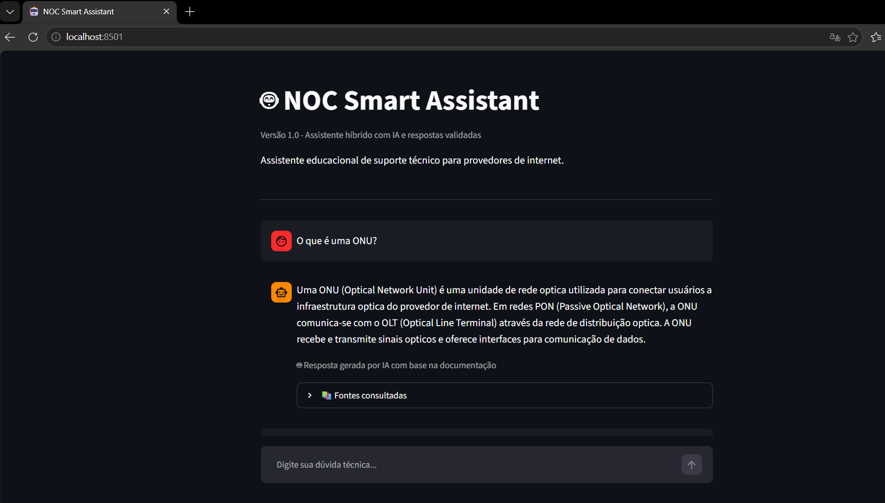
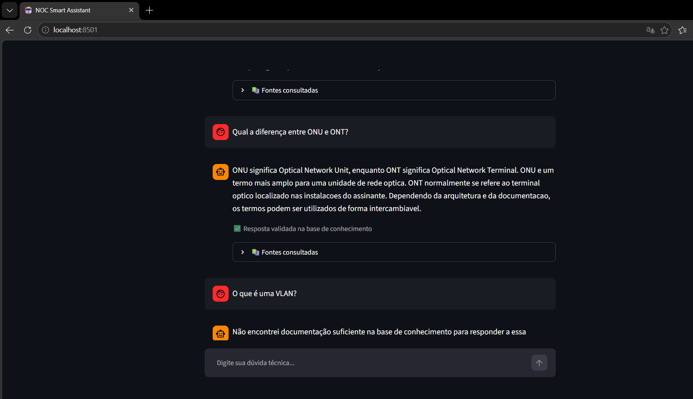
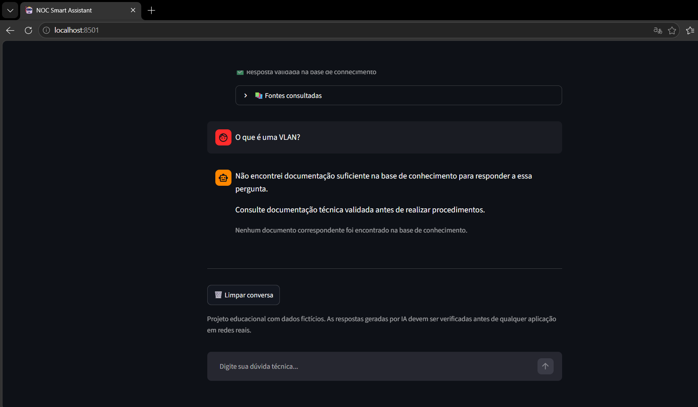

# 🤖 NOC Smart Assistant

Assistente técnico educacional desenvolvido em Python, com integração de Inteligência Artificial Generativa local, recuperação de conhecimento e interface web interativa.

O projeto simula um assistente de suporte técnico para um Centro de Operações de Rede (NOC), utilizando uma base de conhecimento fictícia sobre telecomunicações.

## 🎯 Objetivo

Explorar a aplicação prática de Inteligência Artificial Generativa em um cenário de suporte técnico, combinando:

- Recuperação de informações em documentos estruturados.
- Geração de respostas com um modelo de linguagem local.
- Respostas previamente validadas.
- Tratamento de perguntas sem documentação.
- Testes automatizados do mecanismo de busca.

O projeto foi desenvolvido para fins educacionais e de portfólio.

## ✨ Funcionalidades

- Interface de chat construída com Streamlit.
- Integração com Ollama e Qwen 2.5 1.5B.
- Base de conhecimento externa em JSON.
- Busca por palavras-chave com normalização de texto.
- Priorização de documentos por pontuação.
- Respostas previamente validadas, sem consulta à IA.
- Geração de respostas utilizando documentos recuperados.
- Identificação das fontes utilizadas.
- Histórico de mensagens durante a sessão.
- Tratamento de perguntas sem documentação correspondente.
- Testes automatizados da recuperação de conhecimento.

## 🛠️ Tecnologias utilizadas

| Tecnologia | Utilização |
|---|---|
| Python | Linguagem principal |
| Streamlit | Interface web |
| Ollama | Execução e integração com modelo local |
| Qwen 2.5 1.5B | Geração de respostas |
| JSON | Armazenamento da base de conhecimento |
| Git e GitHub | Versionamento e publicação |

## 🧠 Como funciona

O sistema recebe uma pergunta e procura documentos relevantes em uma base de conhecimento local.

A partir do resultado, utiliza uma das três estratégias:

### 1. Resposta validada

Quando o documento recuperado contém uma resposta previamente validada, o sistema apresenta diretamente esse conteúdo.

Nesse caso, o modelo de IA não é consultado.

### 2. Resposta gerada por IA

Quando existe documentação relevante, mas não há uma resposta previamente validada, o sistema envia o conteúdo recuperado ao modelo Qwen por meio do Ollama.

O modelo recebe instruções para responder com base na documentação fornecida.

### 3. Documentação insuficiente

Quando nenhum documento corresponde à pergunta, o sistema informa que não encontrou documentação suficiente.

Nesse cenário, a IA não é consultada.

### Fluxo simplificado

```text
Pergunta do usuário
        |
        v
Busca na base JSON
        |
        v
Documento encontrado?
    /           \
  Não           Sim
   |             |
   v             v
Informar      Existe resposta
ausência      validada?
de dados       /      \
              Sim      Não
               |        |
               v        v
           Resposta   Consultar
           validada   Qwen/Ollama
               |        |
               v        v
             Exibir resposta
             e documentação
```

## 📁 Estrutura do projeto

```text
noc-smart-assistant/
|
|-- base_conhecimento/
|   |-- equipamentos.json
|
|-- app.py
|-- web_app.py
|-- buscar_conhecimento.py
|-- avaliar_ia.py
|-- testar_busca.py
|-- teste_ia.py
|-- requirements.txt
|-- .gitignore
|-- README.md
```

### Principais arquivos

**web_app.py**

Aplicação principal desenvolvida com Streamlit. Gerencia a interface, o histórico, a recuperação dos documentos e as respostas.

**buscar_conhecimento.py**

Implementa a busca por palavras-chave, normalização e priorização dos documentos.

**base_conhecimento/equipamentos.json**

Contém os documentos técnicos fictícios e as respostas previamente validadas.

**testar_busca.py**

Executa testes automatizados para verificar se o mecanismo de recuperação seleciona os documentos esperados.

**avaliar_ia.py**

Executa perguntas de avaliação para observar as respostas produzidas pelo sistema híbrido.

## 🚀 Como executar

### Pré-requisitos

- Python instalado.
- Ollama instalado e funcionando.
- Modelo Qwen 2.5 1.5B disponível localmente.

### 1. Obter o projeto

Clone o repositório pelo Git ou baixe os arquivos pelo GitHub.

### 2. Instalar as dependências

No terminal, dentro da pasta do projeto:

```bash
python -m pip install -r requirements.txt
```

### 3. Preparar o modelo local

Instale o Ollama, caso ainda não esteja instalado.

Depois execute:

```bash
ollama pull qwen2.5:1.5b
```

### 4. Iniciar a aplicação

```bash
python -m streamlit run web_app.py
```

O Streamlit exibirá um endereço local para acessar a interface pelo navegador.

## 🧪 Testes

### Avaliação da recuperação de documentos

Execute:

```bash
python testar_busca.py
```

No conjunto inicial de dez perguntas, o mecanismo de busca obteve:

- 10 testes aprovados.
- 0 testes reprovados.
- Taxa de acerto de 100% nesse conjunto específico.

Esse resultado não representa uma medida geral de precisão do sistema.

### Avaliação das respostas

Execute:

```bash
python avaliar_ia.py
```

O script permite observar o comportamento do modelo em perguntas documentadas, respostas validadas e situações sem documentação.

A avaliação das respostas ainda é limitada e não constitui uma validação automática de precisão técnica.

## 📚 Base de conhecimento

A base inicial contém documentos educacionais sobre:

- ONU — Optical Network Unit.
- ONT — Optical Network Terminal.
- Diferenças entre ONU e ONT.

Os dados são fictícios ou genéricos, destinados à demonstração da arquitetura do sistema.

Nenhuma informação confidencial de empresas, clientes ou redes reais é necessária para executar o projeto.

## ⚠️ Limitações

- A busca depende das palavras-chave cadastradas.
- A base de conhecimento ainda é pequena.
- O modelo de linguagem pode produzir informações incorretas.
- As respostas geradas não possuem verificação automática de fidelidade.
- Uma resposta validada pode ser utilizada em perguntas relacionadas que exijam informações diferentes.
- O sistema não executa comandos em equipamentos de rede.
- O sistema não possui integração com infraestrutura real.
- O histórico é mantido durante a sessão do Streamlit, sem armazenamento permanente.

## 🔮 Possíveis melhorias

- Ampliação da base de conhecimento.
- Busca semântica com embeddings.
- Avaliação automatizada de recuperação e geração.
- Melhor correspondência entre perguntas e respostas validadas.
- Registro de métricas de desempenho.
- Organização do código em módulos.
- Testes unitários mais abrangentes.
- Melhorias na experiência da interface.

## 🔒 Segurança e uso responsável

Este projeto é exclusivamente educacional.

As respostas não devem ser utilizadas diretamente para executar procedimentos em redes reais sem verificação técnica.

O sistema utiliza uma base de conhecimento local e não exige credenciais ou acesso a ambientes corporativos.

## 👨‍💻 Sobre o projeto

Desenvolvido como projeto de estudo e portfólio para aplicar conceitos de programação Python, Inteligência Artificial Generativa, recuperação de conhecimento, avaliação de respostas e desenvolvimento de aplicações interativas.


## Demonstração da aplicação

O NOC Smart Assistant possui uma interface de conversação desenvolvida com Streamlit, integrada a uma base de conhecimento técnico e a um modelo de IA generativa executado localmente.

### 1. Interface e consulta técnica



### 2. Resposta baseada na documentação



### 3. Tratamento de perguntas sem documentação


